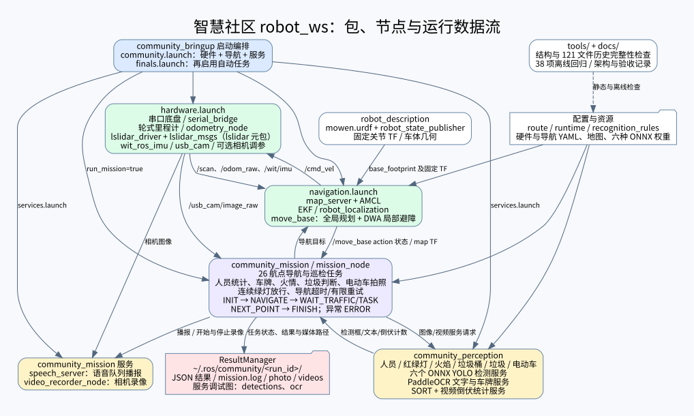

# 整个工作空间架构

图对应 2026-11-06 实际 launch 与源码。实线表示启动依赖或运行数据流；离线检查以虚线表示。
可编辑源文件为 workspace_architecture.dot，另提供 PNG。
各包功能、入口命令和验收状态见 [README](../README.md) 与 [逐步验收](ACCEPTANCE.md)。

TF 主链：map → odom（AMCL）→ base_footprint（EKF）→ 车体固定关节（URDF）；雷达固定 TF 由厂商 launch 发布。
轮式里程计发布 /odom_raw，不重复发布 odom→base TF；最终需现场检查 TF 唯一性与时间戳。
识别按服务请求触发，六模型服务并不自动订阅相机持续推理；任务节点获取图像再调用服务。
视频统计在录像停止后调用，独立于逐帧巡检。

# 功能包合并与接口

| 原包 | 新包 |
| --- | --- |
| community_bringup、community_navigation | community_bringup |
| community_base | community_bringup |
| yolo_onnx_ros、license_plate_ocr、fall_counter | community_perception |
| move_nav、demo01_server_client、video_recorder | community_mission |
| mowen | robot_description |
| lslidar、lslidar_driver、lslidar_msgs、wit_ros_imu | 原名保留 |

## 接口

- community_perception：ObjectDetection、LicensePlateOCR、CountFallStand。
- community_mission：Speech、StartRecording、StopRecording。
- 六份 srv 字段原样保留；导入包名改变，外部旧客户端需要同步重生成。
- /people_detector/detect 等检测服务、/license_plate_ocr、/count_fall_stand、/speech_say、/video_recorder_node/start_recording 和 stop_recording 均保留原名。
- /cmd_vel、/vel_raw、/odom_raw、/odom、/scan、/wit/imu、/usb_cam/image_raw 及 /move_base action 保持不变。

Python 节点和辅助模块统一放在各功能包的 scripts/，通过同目录导入，与 Catkin 生成的 srv 包分离。服务节点仍独立运行，共用一个功能包并不合并进程。

## 启动职责

community_bringup/scripts/ 统一保存 serial_bridge.py、odometry_node.py 和 configure_camera.py；底盘节点原样迁入，节点名称、参数及 Topic 保持不变。

hardware.launch：底盘桥接、轮式里程计、原厂雷达/IMU、USB 相机。
navigation.launch：模型 TF、EKF、地图、AMCL、move_base；原厂雷达 launch 内的静态雷达 TF 保持原样。
services.launch：检测、OCR、视频统计、语音、录像。
community.launch：组合入口；finals.launch：启用原巡检任务的一键入口。

本次实车排查没有修改导航算法、路线、模型权重或串口协议。启动入口的 IMU 默认端口使用 /dev/imu；设备绑定和实测范围见 ACCEPTANCE.md。structure_integrity.json 保存原始及允许的路径/导入替换后哈希；removed_generated 记录移除的厂商目录旧构建产物。厂商实现没有修改。

## 已知问题与实机验证

原 wit CAN/Modbus 脚本存在缩进错误，demo 有 Python 2 语法；默认 normal 驱动保留。原 mowen.urdf.xacro 文件不完整，保持未修复，实际主入口加载 mowen.urdf。来源与许可证声明不因合并改变，SORT 文件头声明仍适用，包元数据 TODO 不代表统一授权。

静态检查不能确认 Catkin 生成服务、系统依赖/ABI、串口协议选择、设备绑定、TF 时序、相机格式、模型推理速度及比赛场地定位。服务调用仍同步阻塞，等待服务 timeout 不代表推理执行超时。上述行为本次未调整，均需工控机验证。
